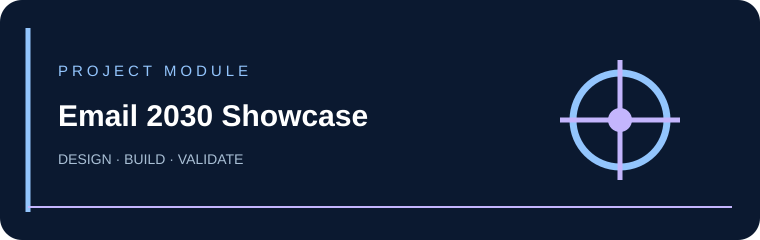

**INDEPENDENT ENGINEERING PORTFOLIO · EMAIL 2030 SHOWCASE**

[GitHub Profile](https://github.com/sghatge) · [Portfolio](https://sghatge.github.io/adobe-campaign-v8-governance/)

---

# Email in 2030: five small demos

Where Adobe Campaign, AJO and AEP style email operations are heading by 2030, shown with small runnable demos.
Synthetic data only. No employer or client material. Python standard library only.

| # | Shift | Folder | Status |
|---|-------|--------|--------|
| 1 | Prompt to journey | `01-prompt-to-journey` | demo + draft |
| 2 | Governance gate for agents | `02-agent-governance` | links ACC Agent Gate |
| 3 | Pre-flight QA agent | `03-preflight-agent` | links Campaign v8 Pre-flight Agent |
| 4 | Email for AI inboxes | `04-ai-readable-email` | demo + draft |
| 5 | Self-optimizing test loop | `05-test-loop` | demo + draft |

Run all tests: `./run_tests.sh` (each demo folder is tested on its own)

---

## Portfolio, reproducibility & safe use

- [Sangram Ghatge — complete engineering portfolio](https://github.com/sghatge/sghatge)
- [OPSFORGE Build Lab](https://sghatge.streamlit.app/) — portfolio index only; this project is documented and maintained in its own repository.

**Reproducibility:** start with the setup and usage instructions in this README and the linked project documentation. Run the repository's available checks before changing behaviour; if no test command is documented, treat that as a validation task rather than assuming tests pass.

**Safe-use boundary:** this is an independent portfolio project. Use synthetic or sanitized examples. Do not treat sample configurations, assessments, checklists or simulated outputs as production approvals or connect the project to customer data or live enterprise systems without independent security, privacy, legal and operational review. Review dependencies, licences and secrets handling before deployment.
